# UVM-based SPI / I²C Protocol System Verification

SPI와 I²C Master / Slave RTL을 SystemVerilog로 설계하고, **Basys 3 보드 2대 간 실측(Logic Analyzer)** 과 **UVM 기반 자동 검증**으로 동작을 확인한 개인 프로젝트입니다.

| 항목 | 내용 |
|---|---|
| 기간 | 2026.06.11 ~ 2026.06.18 |
| 형태 | 개인 프로젝트 |
| 보드 | Digilent Basys 3 (Artix-7 XC7A35T) × 2, 100 MHz |
| 검증 | UVM · Scoreboard · Functional Coverage · Synopsys VCS / Verdi |
| 실측 | USB Logic Analyzer (24 MHz, 8-Channel) |

## 핵심 결과

- I²C Valid Address 랜덤 **2,000건**(WRITE 992 / READ 1,008): PHY ADDR · PHY DATA · PAR DATA · ADDR ACK · DATA ACK **전 항목 PASS**
- I²C Invalid → Valid Recovery 40건(Invalid 20 + Valid 20): NACK 직후 정상 트랜잭션 복구 **전 건 PASS**
- SPI Master→Slave / Slave→Master / Full-Duplex Random 3개 시나리오 **Scoreboard PASS**, Coverage로 시나리오별 Bin 도달 확인
- 보드 간 CDC 문제를 **2-FF Synchronizer**로 해결하고 Logic Analyzer 실측 파형으로 확인

## 사양

| 항목 | SPI | I²C |
|---|---|---|
| 통신 | Synchronous Serial, Full Duplex | Synchronous Serial, Half Duplex |
| 버스 | `SCLK` `MOSI` `MISO` `SS_N` · CPOL=0, CPHA=0 (Mode 0) | `SCL` `SDA` · Open Drain + Pull-up |
| 구성 | Master 1 : Slave 1 | Master 1 : Slave 2 (`7'h10`, `7'h20`) |
| 동작 | `clk_div = 8` | Write / Read (Loopback) |

| SPI 구조 | SPI Mode (CPOL / CPHA) |
|---|---|
| 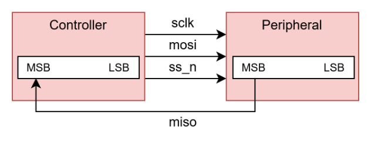 | 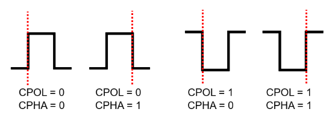 |

| I²C 구조 (Open Drain + Pull-up) | I²C START / DATA / STOP |
|---|---|
| 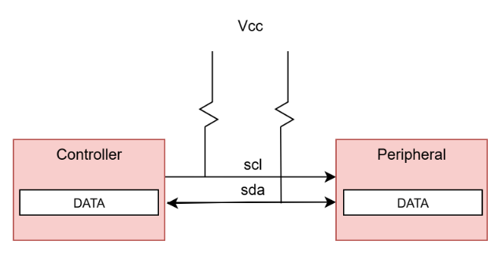 | 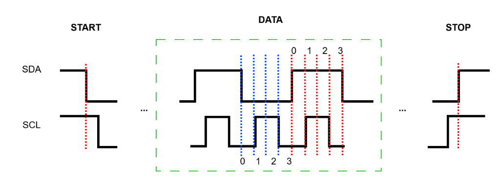 |

**I²C Command Process**: START → Addr[6:0] + R/W → ACK → Data[7:0] → ACK / NACK → STOP

<p align="center">
  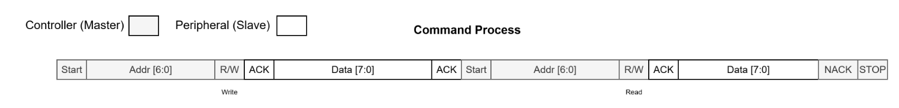
</p>

## 시스템 구조

### SPI

Master 보드의 스위치 값을 SPI로 전송하고, Slave 보드가 FND에 표시한 뒤 응답 데이터를 돌려보냅니다.

<p align="center">
  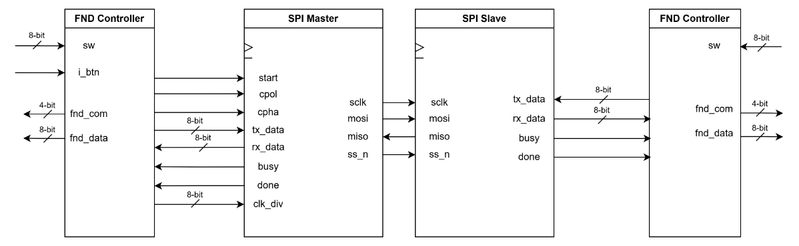
</p>

| SPI Master FSM | SPI Slave FSM |
|---|---|
| 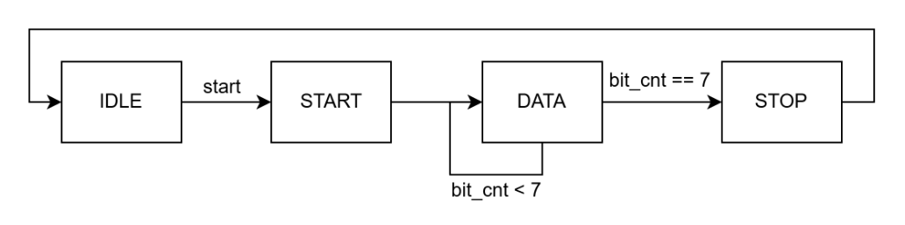 | 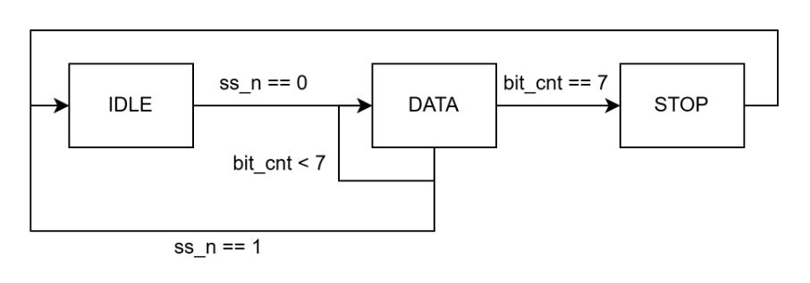 |

### I²C

Master 1개와 주소가 다른 Slave 2개(`7'h10`, `7'h20`)를 같은 `SCL` · `SDA` 버스에 연결했습니다.

<p align="center">
  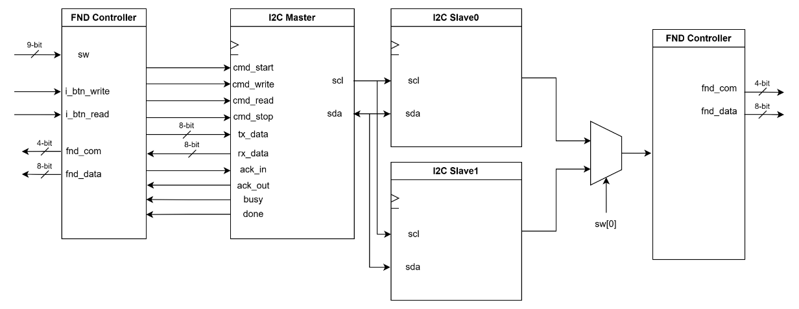
</p>

**버튼 명령 FSM**: Write 버튼은 W_START → W_ADDR → W_DATA → W_STOP, Read 버튼은 R_START → R_ADDR → R_DATA → R_STOP 순서로 Master에 명령을 보냅니다.

<p align="center">
  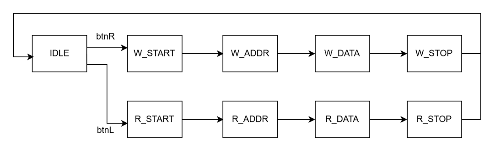
</p>

| I²C Master FSM | I²C Slave FSM |
|---|---|
| 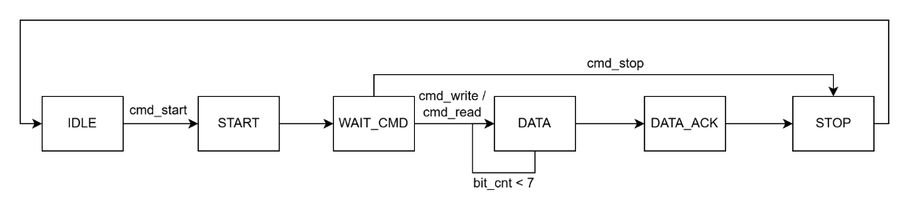 | 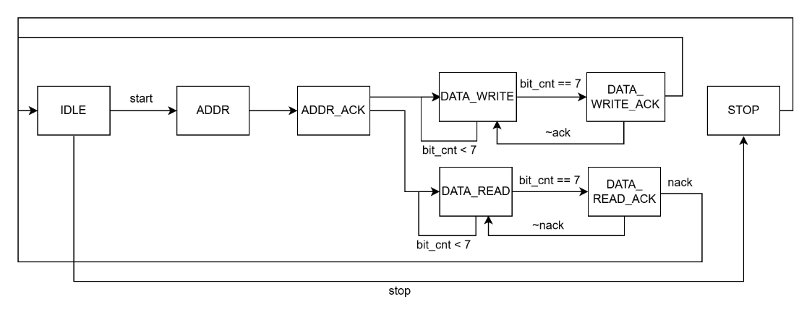 |

## FPGA 실측 (Logic Analyzer)

- SPI

<p align="center">
  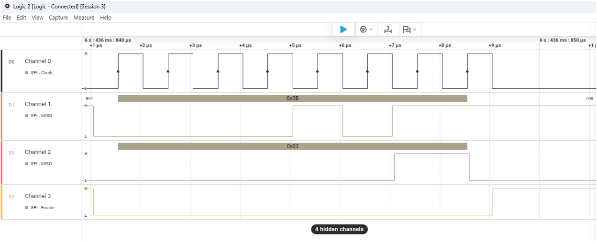
</p>

- I²C Write (`0x20` + ACK)

<p align="center">
  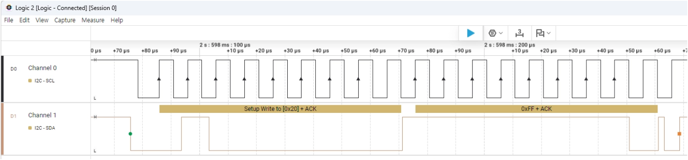
</p>

- I²C Read (`0x20` + NAK)

<p align="center">
  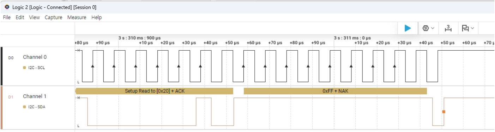
</p>

## 검증 환경

```text
Sequence → Sequencer → Driver → Interface → SPI / I²C DUT
                                              │
                                           Monitor
                                     ┌────────┴────────┐
                                Scoreboard     Functional Coverage
```

<p align="center">
  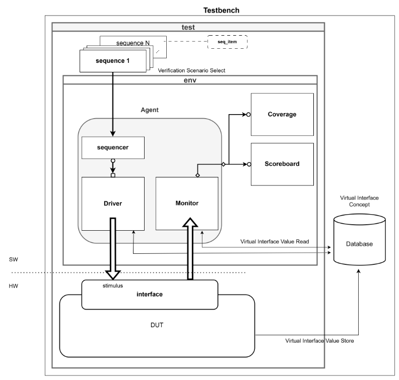
</p>

| 프로토콜 | 시나리오 | 검증 내용 |
|---|---|---|
| SPI | Master → Slave | Controller `tx_data`와 `MOSI` 비교, Slave `tx_data` 0 고정 |
| SPI | Slave → Master | Peripheral `tx_data`와 `MISO` 비교, Master `tx_data` 0 고정 |
| SPI | Random | 양쪽 `tx_data` Randomize, Full-Duplex PASS/FAIL |
| I²C | Invalid Address | 없는 주소 접근 시 NACK 발생 · Slave 레지스터 미저장 |
| I²C | Invalid → Valid Recovery | NACK 직후 정상 주소 트랜잭션 복구 |
| I²C | Random (Valid Address) | 유효 주소 대상 Write/Read · Data Randomize, 2,000건 |

Coverage는 시나리오마다 해당 Bin만 Hit되는지 확인하는 용도로도 사용했습니다. 예를 들어 Invalid Address 시나리오에서는 `addr_ack` Bin 중 `nack`만 Hit되어야 합니다.

### 결과

**SPI Random (Full Duplex) 1,000건**

| Scoreboard Report | Coverage Report |
|---|---|
| 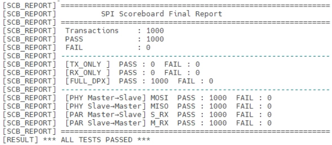 | 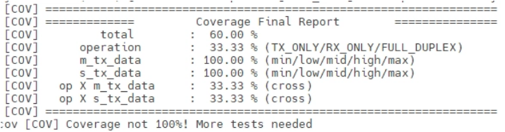 |

**I²C Invalid → Valid Recovery 40건 / Random 2,000건**

| Recovery Scoreboard (40 / 40 PASS) | Random Scoreboard (2,000 / 2,000 PASS) |
|---|---|
| 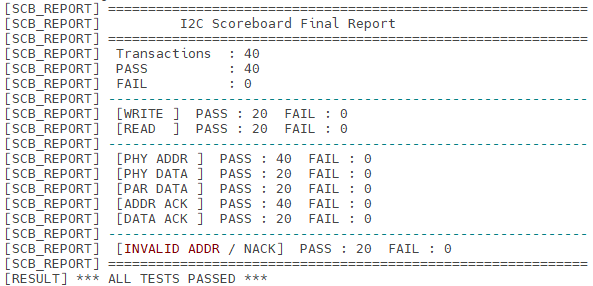 | 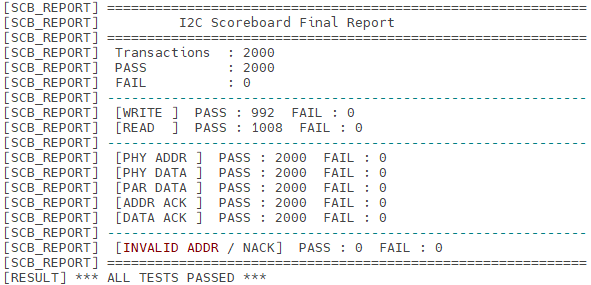 |

<p align="center">
  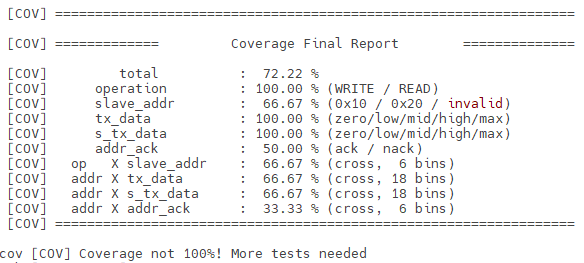
</p>

## 디렉터리 구조

```text
.
├── SPI/            # spi_master · spi_slave · 보드별 top · FND · debounce · TB
├── I2C/            # i2c_master · i2c_slave · 보드별 top · demo · FND · TB
├── UVM/
│   ├── SPI/        # spi_if · seq_item · sequence · driver · monitor · agent · scoreboard · coverage · env · test
│   └── I2C/        # i2c_if · seq_item · sequence · driver · monitor · agent · scoreboard · coverage · env · test · tb_top
└── docs/           # README 이미지
```

## 배운 점

- 보드 간 통신은 시뮬레이션만으로는 드러나지 않는 CDC 문제가 생길 수 있어 Logic Analyzer 실측이 필요했습니다.
- Coverage를 단순 달성률이 아니라 "이 시나리오에서 의도한 Bin만 Hit되는가"를 확인하는 도구로 쓸 수 있었습니다.
